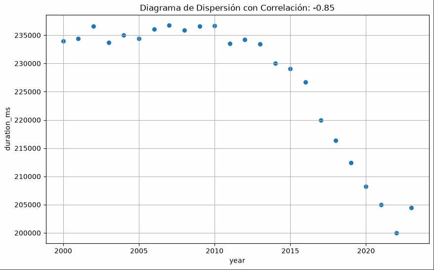
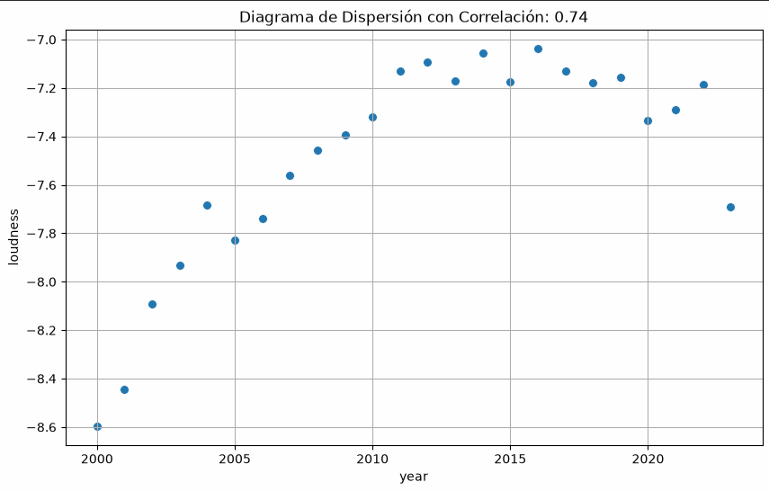
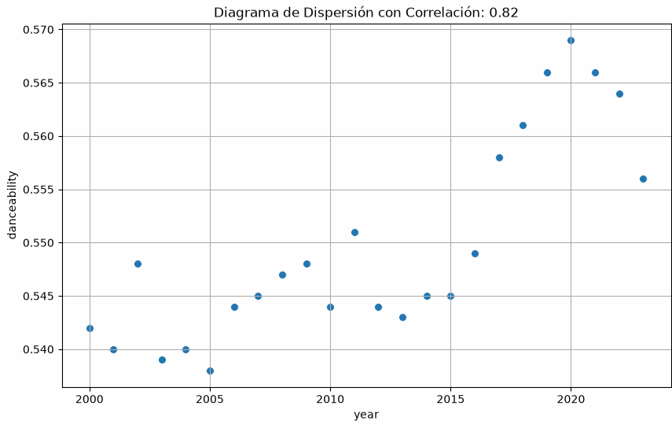
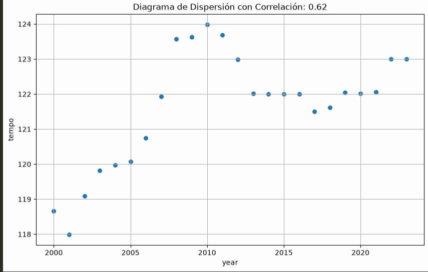
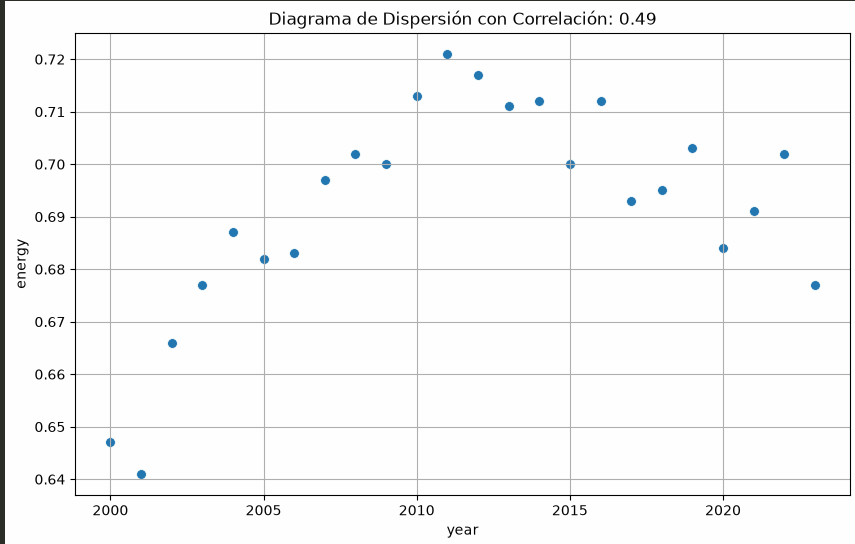
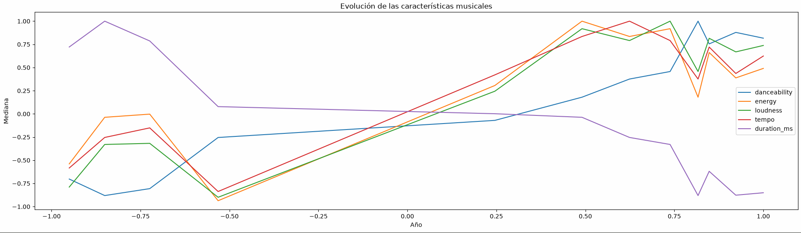

# EDA_MUSICA
### Análisis de la evolución de las tendencias musicales

---

## 1. HIPÓTESIS PRINCIPAL

**H1: La música popular tiende a volverse progresivamente más corta, ruidosa, bailable y rápida.**

**Explicación:**

La música ha experimentado una transformación paralela a la de los hábitos de consumo de la sociedad contemporánea. Su progresiva integración en plataformas digitales y servicios de streaming podría haber favorecido su conversión en un producto de consumo inmediato, donde captar rápidamente la atención del oyente adquiere cada vez mayor importancia.

Esta transformación podría manifestarse en canciones de menor duración, mayor intensidad sonora, mayor bailabilidad y tempos más elevados.

### Variables de estudio

| Característica | Variable | Tendencia esperada |
|---|---|---|
| Duración | `duration_ms` | Disminución |
| Intensidad sonora | `loudness` | Aumento |
| Bailabilidad | `danceability` | Aumento |
| Velocidad | `tempo` | Aumento |
| Intensidad musical | `energy` | Aumento |

---

## 2. ANÁLISIS EXPLORATORIO DE DATOS (EDA)

### 2.1. Evolución de la duración musical

**Objetivo:** estudiar si la duración media y mediana de las canciones ha disminuido con el paso de los años.

**Explicación e interpretación:**

Dado que los datos utilizados en esta gráfica se basan en la mediana de la duración de la música esta correlación solo aplica a la música popular NO al conjunto entero, dicho esto se aprecia una correlación negativa fuerte entre ambas variables (-0.86)

---

### 2.2. Evolución de la intensidad sonora

**Objetivo:** analizar si las canciones presentan progresivamente una mayor intensidad sonora.

**Explicación e interpretación:**
Es evidente a simplevista la correlación entre tiempo y smayor sonoridad.

---

### 2.3. Evolución de la bailabilidad

**Objetivo:** comprobar si la música popular ha evolucionado hacia canciones con mayor bailabilidad.

**Explicación e interpretación:**

---

### 2.4. Evolución del tempo

**Objetivo:** estudiar si existe una tendencia hacia canciones con tempos más elevados.

---

### 2.5. Evolución de la energía musical

**Objetivo:** analizar los cambios históricos en la intensidad y actividad percibida de las canciones.

---

## 3. ANÁLISIS DE CORRELACIONES

**Objetivo:** estudiar las relaciones entre las características musicales y su posible asociación con la popularidad y el año de publicación.

**Explicación e interpretación:**

Gráfica meramente ilustrativa

## 5. CONCLUSIONES

### 5.1. Contraste de la hipótesis principal

La hipótesis principal queda respaldada por el estudio multivariable, esto evidentemente no demuestra ningún tipo de causalidad, solo y unicamente que hay una relación.
Como revelación inesperada me di cuenta que usando el grueso de la música esta misma no tiende realmente a hacerse corta, ruidosa, etc. Dando asi una distribucion más homogenea.

### 5.2. Limitaciones del estudio

No encontre especiales sesgos o problemas de resentabilidad dentreo del dataset.

### 5.3. Conclusión final

Si bien se confirma la hipótesis principal también fueron encontradas mas relaciones entre otras variables dentro del mismo data set ya sean entre generos musicales con su duracion y posible relacion negativa o positiva con la popularidad de las canciones producidas dentro de ese mismo genero así como otras tantas.

---

## 6. TECNOLOGÍAS Y HERRAMIENTAS UTILIZADAS

| Tecnología | Utilidad |
|---|---|
| Python | Lenguaje de programación principal. |
| Pandas | Limpieza, transformación y manipulación de datos. |
| NumPy | Operaciones numéricas y tratamiento de valores. |
| Matplotlib | Creación de visualizaciones. |
| Seaborn | Visualización estadística y análisis exploratorio. |
| SciPy | Análisis estadístico y pruebas de hipótesis. |
| Jupyter Notebook | Desarrollo y documentación del EDA. |

---

## 7. DATASET Y FUENTES

**Dataset:** spotify_1million_tracks

**Fuente:** https://www.kaggle.com/datasets/amitanshjoshi/spotify-1million-tracks

**Periodo temporal analizado:** [2000-2023]

**Número de registros:** 1159764

**Número de variables:** 16

